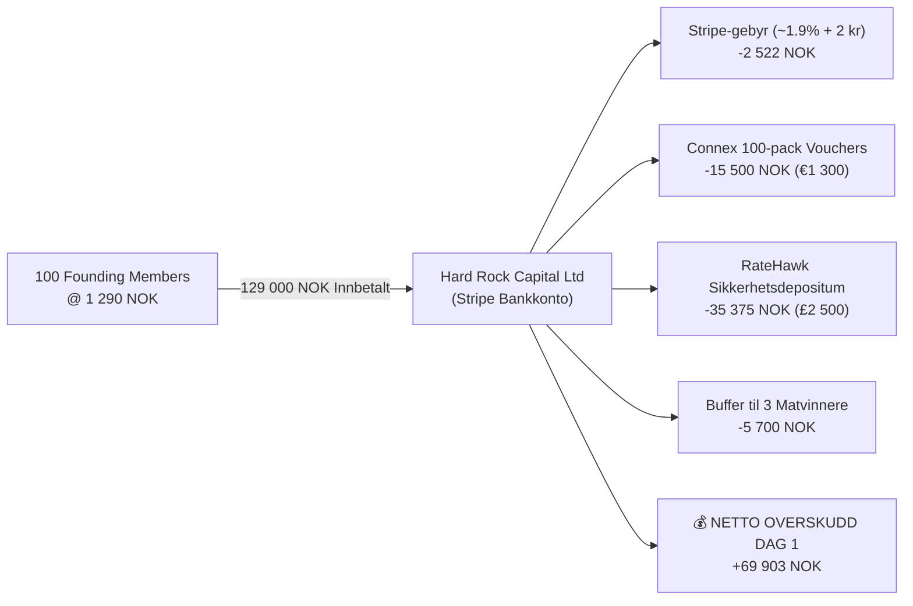

# 🚀 ATLAS TRAVEL CLUB — LANSERINGSPLAN & 0 KR MARKEDSSTRATEGI (JANUAR 2027)

> **Juridisk Enhet:** HARD ROCK CAPITAL LTD (Selskapsnr. 16833237, England & Wales)  
> **Registrert Adresse:** 71-75 Shelton Street, Covent Garden, London, WC2H 9JQ, Storbritannia  
> **Gründer & Daglig Leder:** Pål Juritzen (`paljuritzen@gmail.com` | `+47 40059493`)  
> **Plattform:** [atlasclub.web.app](https://atlasclub.web.app) | **Prelaunch:** [atlasprelaunch.web.app](https://atlasprelaunch.web.app)  
> **Mål:** 100 betalende Founding Members @ 1 290 NOK = **129 000 NOK i kontantstrøm på Dag 1**  
> **Lanseringsdag:** **Mandag 4. januar 2027 kl. 10:00 CET**

---

## 1. Strategisk Bakteppe: Hvorfor Januar 2027 er en «Home Run»

I den globale reiselivsbransjen er januar årets ubestridte salgstoppunkt («Turnaround January»):
1. **Reisesøket eksploderer**: Fra 1. til 31. januar foretas over 30% av årets samlede sommer- og feriebestillinger. Nordmenn sitter hjemme i kulden etter jul og søker aktivt etter ferier.
2. **Timing for verdigarantien**: Når ATLAS åpner medlemskapet 4. januar og tilbyr **0 kr påslag på fly/hotell + et 100% gratis 3-dagers luksushotellopphold for to (verdi 5 400 kr)**, treffer vi forbrukeren i det eksakte øyeblikket de uansett skal dra kortet for ferien.
3. **10 ukers rolig rullebane**: Gir full kontroll til å samle 300–500 kvalifiserte kandidater på ventelisten uten julestress eller dyre annonsekampanjer.
4. **Overtegning sikrer Dag 1-salget**: Med 300–500 på ventelisten og kun 100 plasser med gratis hotell, utløses en ekstrem knapphets- og tapsaversjonseffekt som river bort plassene på minutter.

---

## 2. Finansiell Flyt & Kontantstrøm på Lanseringsdagen

Medlemmene betaler **full kontingent på 1 290 kr**. Det gis ingen rabatt på selve årsavgiften; verdien ligger i den overdådige gaven (hotellopphold verdt 5 400 kr + sjansen til å vinne all mat dekket).

> [!IMPORTANT]
> **RateHawk-kredittlinje aktivert**: Det refunderbare depositumet på £2,500 gir Hard Rock Capital Ltd en rullerende kredittlinje på **£5,000 (~70 750 kr)**, som ved ukentlig oppgjør støtter over **3,4 millioner NOK** i årlig hotellomsetning!

---

## 3. Den Automatiske E-posttrakten (Nurture → Urgency → Forfeiture)

Mellom registrering og lanseringsdag sendes en automatisert sekvens som bygger troverdighet, forklarer modellene transparent, og bygger opp til 4. januar kl. 10:00:

| E-post | Utsending | Tema / Emnefelt | Psykologisk Hensikt |
| :--- | :--- | :--- | :--- |
| **#1** | **Dag 0** (Umiddelbart) | `👑 Velkommen til ATLAS: Din Founding Member-kvote er reservert` | Bekrefter posisjon, tildeler invite-kode, etablerer **48t tapsaversjonsregelen**. |
| **#2** | **Dag 4** | `🍷 Hvordan kan hotellrommet være 100% gratis? (Sannheten om hotell-allotments)` | Fjerner skepsis. Viser overskuddsmodellen og transparent halvpensjonsøkonomi. |
| **#3** | **Dag 9** | `🏖️ 7 netter i Marbella eller Tenerife for 3 490 kr? Her er beviset` | Viser familiebesparelsen på 15 000 kr via RVC / Panorama-nettverket. |
| **#4** | **Dag 16** | `🕵️ Hvorfor koster hoteller det samme på alle nettsider? (Prisparitet)` | Avslører Booking/Expedia-duopolet og forklarer hvorfor lukkede klubber har lov til 0 kr påslag. |
| **#5** | **28. des** (Romjul) | `📅 Datoen er satt: Mandag 4. januar kl. 10:00 åpner ATLAS` | Skaper forventning midt i ferieplanleggingen. Varsler om at kun 100 av 400+ får plassen. |
| **#6** | **4. jan kl. 10:00** | `🚨 DØRENE ER ÅPNE: Sikre ditt Founding Membership & gratis hotell nå` | **Kjøpsutløser**: Direkte Stripe-lenke. Førstemann-til-mølla. |
| **#7** | **5. jan kl. 20:00** | `⚠️ Siste sjanse: Plassen din frigis til neste på ventelisten i morgen kl. 12:00` | Tapsaversjon. Nedtelling til 48-timersfristen. |

---

## 4. Den Komplette 0 KR Organiske Markedsplanen (Hvordan nå 300–500 på ventelisten)

Du trenger ikke bruke én eneste krone på betalte annonser for å få 300–500 reiselystne nordmenn på ventelisten. Her er 5 velprøvde, organiske taktikker:

### Taktikk 1: Viral Henvisningsløkke («Rykke frem i køen»)
* **Mekanisme**: Hver person som registrerer seg får en unik lenke: `https://atlasprelaunch.web.app?ref=ATLAS-1049`.
* **Incentiv**: *«Del lenken din med 3 venner. For hver venn som reserverer plass, rykker du 10 plasser frem i køen, slik at du er garantert å nå de 100 første som får gratis hotellopphold.»*
* **Plassering**: Vises umiddelbart i Trinn 3 på kvitteringsskjermen med én-klikks kopiering for WhatsApp, SMS og Messenger.

### Taktikk 2: Trojanske Hest-innlegg på LinkedIn & Facebook (Avsløringsformat)
Folk deler ikke reklame, men de deler **forbrukeravsløringer** som sparer dem penger. Pål Juritzen poster som gründer:
* **Innlegg 1 (LinkedIn/FB)**: 
  * *Tittel*: «Hvorfor koster et rom på Marriott i Roma nøyaktig 3 400 kr på Booking.com, Hotels.com og Expedia?»
  * *Innhold*: Forklar klausulen om Rate Parity (prisparitet), de 15–25% provisjonene som forbrukeren betaler for å finansiere TV-reklamer, og hvordan den lukkede medlemsmodellen (Costco for reiser) omgår dette lovlig.
  * *CTA*: «Vi slipper de første 100 medlemmene i januar. Reserver plass her: atlasprelaunch.web.app».
* **Innlegg 2 (Reisegrupper)**:
  * *Tema*: «Her er det faktiske regnestykket bak 0 kr i rompris på boutiquehoteller i Dolomittene og Toscana».
  * *Deling*: I reiseentusiast-grupper på Facebook («Reisetips Italia/Spania», «Ferie i Europa», «Bonusjegere Norge»).

### Taktikk 3: Forbrukerrettet PR & Medieinnsalg (Nettavisen, E24, Flysmart24, DinSide)
Reiselivsjournalister elsker saker om overprising og utfordrere til reisebyråene før januar-salget.
* **Pressevinkel**: 
  > *«Norsk seriegründer utfordrer Booking.com og Expedia: Lanserer medlemsklubb med 0 kroner i påslag og gir bort hotellopphold til de første 100.»*
* **Pitch-punkter til journalisten**:
  1. Hvor mye milliarder nordmenn taper årlig på skjulte OTA-påslag.
  2. ATLAS sin modell: 100% uavhengig, 0 kr provisjon, 100% provisjonsrefusjon på cruise/bil.
  3. Tilbud om eksklusivt intervju og innsyn i grossistprisene vs. åpne søkemotorer.

### Taktikk 4: «Corporate Perks» for Små og Mellomstore Bedrifter (SMB)
* Ta kontakt med 20–30 daglige ledere i eget nettverk (venner, bekjente, tidligere kolleger):
* *Pitch*: «Hei [Navn], vi lanserer ATLAS i januar. Som en eksklusiv førjulsgave til dine ansatte kan de få prioritert tilgang på ventelisten for å sikre seg et gratis 3-dagers hotellopphold for 2 og reiser til kostpris. Koster bedriften 0 kr. Vil du dele denne interne lenken med teamet?»
* Én bedrift med 30 ansatte gir ofte 10–15 umiddelbare venteliste-registreringer.

### Taktikk 5: Miljøet for «Bonusjegere» & Poengsamlere (Flyprat, InsideFlyer)
* Folk som samler EuroBonus og hotellpoeng er ekstremt opptatt av marginer, nettopriser og Duffel/NDC-flybilletter.
* Presenter ATLAS sin Rewards Vault og 100% kickback på cruise/leiebil som et alternativ til tradisjonelle kredittkortprogrammer.

---

## 5. Tidslinje og Milepæler mot 4. Januar 2027

| Dato | Milepæl | Mål |
| :--- | :--- | :--- |
| **Uke 43–47 (Okt–Nov)** | **Organisk verving starter** | De første 100–150 på ventelisten via personlig nettverk, LinkedIn og venneverving. |
| **Uke 48–50 (Desember)** | **Presseinnsalg & B2B Perks** | Ventelisten når 250–350 personer. Nurture-e-postene ruller automatisk. |
| **28. des – 3. jan** | **Romjulsoppkjøring** | E-post #5 sendes. Ventelisten passerer 400. Lanseringstidspunkt kl. 10:00 bekreftes. |
| **Mandag 4. jan kl. 10:00** | **🚀 LAUNCH MOMENT** | E-post #6 sendes. Stripe åpner. **Mål: 100 betalinger @ 1 290 NOK = 129 000 NOK.** |
| **Onsdag 6. jan kl. 12:00** | **48t Deadline** | Uavhentede plasser overføres til ventelisten. Siste plasser fylles. |
| **Torsdag 7. jan** | **Leverandøroppgjør** | RateHawk-depositum (£2 500) overføres. Connex-kuponger distribueres digitalt. |
| **Fredag 8. jan** | **Golden Ticket-trekning** | 3 vinnere kåres som får maten dekket. Medlemmer begynner å booke ferier! |

---

## 6. Sjekkliste for Gründerskap & Drift

- [x] Prelaunch-app oppdatert og rullet ut på `atlasprelaunch.web.app` og `atlaslaunch.web.app`.
- [x] Hotellpass 0 kr kalkulator & RVC 7-netters kalkulator tilgjengelig i modal uten å forstørre skjemaet.
- [x] Tapsaversjons- og køregler («overføres til neste på ventelisten») integrert på alle berøringspunkter.
- [x] E-postsekvens forberedt i `src/lib/nurtureEmailSequence.ts`.
- [ ] Pål poster det første «Rate Parity»-innlegget på LinkedIn / Facebook i begynnelsen av november.
- [ ] Pål sender uformell e-post til 20 venner/ledere i nettverket med invitasjon til ventelisten.
- [ ] Svare Rafael Rodriguez hos RateHawk om at Hard Rock Capital Ltd aksepterer £2 500-depositumet for signering mot januar.
